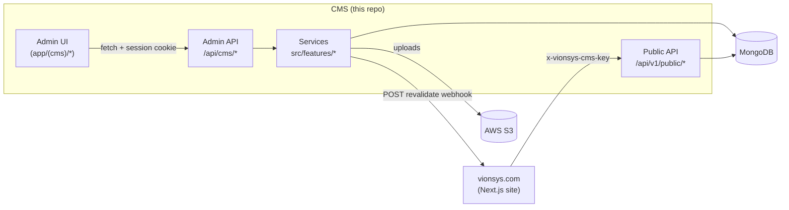

# Vionsys CMS

Headless content management system for the blogs and case studies published on [vionsys.com](https://www.vionsys.com).

Editors write and manage content in this app. The public website does not share a database with it: it reads published content through a key-protected REST API (`/api/v1/public/*`), and the CMS tells the website to refresh its cache whenever published content changes.

> Engineering standards for this repo live in [rule.md](rule.md). Read it before opening a PR.

---

## Contents

- [Tech stack](#tech-stack)
- [How it works](#how-it-works)
- [Project structure](#project-structure)
- [Data model](#data-model)
- [Roles and permissions](#roles-and-permissions)
- [API overview](#api-overview)
- [Getting started](#getting-started)
- [Environment variables](#environment-variables)
- [Scripts](#scripts)
- [Deployment (Vercel)](#deployment-vercel)
- [Known limitations](#known-limitations)
- [Further docs](#further-docs)

---

## Tech stack

| Layer | Technology |
|---|---|
| Framework | Next.js **16.2** (App Router, Turbopack), React **19.2**, TypeScript (strict) |
| Database | **MongoDB** through Prisma ORM **5.22** |
| Auth | Custom JWT session in an `httpOnly` cookie (`jsonwebtoken` + `bcryptjs`) |
| Editor | **Editor.js** (header, list, table, quote, code, raw HTML, image, underline) |
| Media storage | AWS S3 (`@aws-sdk/client-s3`) |
| Validation | Zod 4 (schemas in `src/features/*/*.validation.ts`) |
| Styling | Tailwind CSS 4, design tokens in `src/styles/tokens.css` |
| UI | `lucide-react` icons, `framer-motion` animations |
| Hosting | Vercel |

> Next.js 16 has breaking changes from earlier versions. The docs that match the installed version are in `node_modules/next/dist/docs/`. Check them before relying on older patterns.

---

## How it works



### 1. Authentication

1. `/login` posts the email and password to `POST /api/cms/auth/login`.
2. The password is checked with bcrypt. On success a 24-hour JWT is set in the `vionsys_cms_token` cookie (`httpOnly`, `sameSite=lax`, `secure` in production).
3. `src/middleware.ts` does an **optimistic** check: admin paths without a cookie are redirected to `/login`.
4. The real check happens on the server:
   - Pages call `requireAuthPage()` ([require-auth.ts](src/features/auth/require-auth.ts)).
   - Route handlers call `requireAuth()` or `authorizeUser(permission)` ([rbac.ts](src/features/auth/rbac.ts)).

**First-run bootstrap:** while the `User` collection is empty, logging in as `admin@vionsys.com` / `admin123` creates a `SUPER_ADMIN` account. Change that password immediately in any shared environment. There is no user-management UI yet, so other users must be added directly in the database.

### 2. Content lifecycle (blog posts)

```
Create ─► Edit (autosave every 30 s + on window blur) ─► Publish ─► Revalidate frontend
                     │                                      │
                     └─► VersionHistory (last 20 kept)      └─► slug change ⇒ 301 Redirect record
```

- **Editor:** [ContentEditorShell.tsx](src/components/cms/editor/ContentEditorShell.tsx) runs the page. It holds the form state, runs autosave, and has side panels for Document, SEO, AEO/GEO, Schema, and Publish.
- **Body content:** [RichTextEditor.tsx](src/components/cms/editor/RichTextEditor.tsx) loads Editor.js on the client only. On every change it turns the blocks into HTML and plain text with [editorjs-parser.ts](src/lib/editorjs-parser.ts). Three copies are stored: `contentJson` (to reload the editor), `contentHtml` (for the website), and `contentText` (for search and metrics).
- **Saving:** `POST /api/cms/blogs` creates a post and `PUT /api/cms/blogs/:id` updates one. Both go through [BlogService](src/features/blogs/blog.service.ts), which:
  - checks that the slug is unique,
  - creates the SEO, AEO/GEO, and schema meta records the first time a post is saved ([content-meta.ts](src/lib/content-meta.ts)),
  - writes an `ActivityLog` entry,
  - writes a `VersionHistory` snapshot when the content changed, keeping the last 20 ([version-history.ts](src/lib/version-history.ts)),
  - adds a `301` redirect from the old URL when a published post's slug changes,
  - calls [RevalidationService](src/features/publishing/revalidation.service.ts) when the post is or was published.
- **Status:** `DRAFT`, `SCHEDULED`, `PUBLISHED`, `ARCHIVED`. Moving to `PUBLISHED` sets `publishedAt`.
- **Delete:** a post that was ever live gets a `301` redirect to `/blog`, then the frontend is revalidated.

### 3. Case studies

Case studies use the same pipeline in [case-study.service.ts](src/features/case-studies/case-study.service.ts), with two rich-text sections (`challenge`, `approach`) and structured child records: `ResultStat`, `ProcessStep`, `MediaGalleryItem`, `CaseStudyFaq`, plus testimonial and CTA fields.

The `CaseStudy` model has **no `status` field**: a case study counts as published when `publishedAt` is set.

### 4. Frontend cache revalidation

When published content changes, `RevalidationService` sends:

```http
POST {FRONTEND_REVALIDATE_URL}
x-revalidate-secret: {FRONTEND_REVALIDATE_SECRET}
Content-Type: application/json

{ "paths": ["/", "/blog", "/blog/<slug>", "/sitemap.xml", "/sitemap-blog.xml"],
  "action": "update", "contentType": "blog", "slug": "<slug>" }
```

The request times out after 10 seconds. A failure is logged but does **not** fail the save.

### 5. Draft preview

1. The editor opens `GET /api/cms/preview?id=<id>`.
2. The CMS signs the ID with HMAC-SHA256 (key: `JWT_SECRET`) and redirects to `{VIONSYS_FRONTEND_BASE_URL}/blog/preview?id=…&token=…` (or `/case-studies/preview`).
3. The website calls `GET /api/cms/preview/<token>?id=<id>&type=blog|case-study`, and the CMS returns the draft if the signature matches.

When the CMS runs on `localhost` and the frontend URL is `https://vionsys.com`, preview redirects to a local frontend instead (port 3001 if the CMS is on 3000).

There is also an in-CMS preview at `/blogs/:id/preview` and `/case-studies/:id/preview`.

### 6. Media

- `POST /api/cms/upload` takes `multipart/form-data` (`files` or `file`, plus an optional `folderId`).
- [StorageAdapter](src/features/media/storage-adapter.ts) checks the MIME type against `siteConfig.storage.allowedMimeTypes`, gives the file a unique key under `uploads/`, and uploads it to S3. A `MediaAsset` record stores the public S3 URL.
- Deleting an asset removes both the record and the S3 object.
- Folders are virtual (`MediaFolder`, path-based).
- Files in `public/uploads/` are leftovers from local-disk storage. New uploads go to S3.

### 7. SEO, AEO, and GEO tooling

- **Live editor metrics** in [ContentIntelligenceBar](src/components/cms/editor/ContentIntelligenceBar.tsx): reading time, readability, keyword density, and heading outline (`src/lib/*`).
- **SEO score:** [score-calculator.ts](src/features/seo/score-calculator.ts).
- **JSON-LD:** [schema-generator.ts](src/features/seo/schema-generator.ts) builds `BlogPosting` and case-study schema, merged with `SchemaSettings.customSchemaJson`.
- **Public SEO feeds:** sitemap, robots, redirects, and an `llms.txt` catalogue, served from `/api/v1/public/*`. The frontend turns these into real `sitemap.xml` and `robots.txt` files.
- **Publish checklist:** [publish.service.ts](src/features/publishing/publish.service.ts) defines blockers and warnings (meta title and description, alt text, schema type, at least 2 result stats for case studies). It is **not yet enforced** by the save API. See [rule.md §12](rule.md#12-known-violations-in-this-repo).

---

## Project structure

```
prisma/schema.prisma          MongoDB data model (single source of truth)
scripts/migrate-seo-fks.mjs   One-off migration for SEO meta foreign keys
docs/                         Architecture, API contract, env, frontend integration
src/
├── middleware.ts             Optimistic auth redirect + CORS for /api/v1/public/*
├── app/
│   ├── (auth)/login/         Login page
│   ├── (cms)/                Admin pages (route group, no URL segment)
│   │   ├── dashboard/        Counts + recent activity
│   │   ├── blogs/            List, new, [id]/edit, [id]/preview
│   │   ├── case-studies/     List, new, [id]/edit, [id]/preview
│   │   ├── media/            Media library
│   │   ├── seo-tools/        Redirects, robots, schema, sitemap (read-only views)
│   │   └── settings/         API keys, general, LLMs, taxonomy, users
│   └── api/
│       ├── cms/              Admin API (session cookie + RBAC)
│       └── v1/public/        Public read API (API-key protected)
├── features/                 Business logic per domain (the data access layer)
│   ├── auth/                 JWT session, RBAC, API-key validation, page guards
│   ├── blogs/                service · mapper (admin/public DTO) · validation
│   ├── case-studies/         service · mapper · validation
│   ├── media/                service · S3 storage adapter · validation
│   ├── publishing/           publish checks · preview tokens · revalidation
│   └── seo/                  robots · sitemap · schema · score
├── components/cms/           UI: editor/, layout/, media/, shared/
├── lib/                      prisma client, env, errors, ApiResponse, text utilities
├── config/                   permissions (RBAC matrix), site config, taxonomy
├── types/                    Shared TS types (api, content, seo, user…)
└── styles/tokens.css         Design tokens
```

**Layering:** `app/` (pages and route handlers) → `features/*` services → `lib/prisma`. Route handlers stay thin: authenticate, parse input, call a service, return `ApiResponse`. Mappers (`*.mapper.ts`) decide which fields leave the server (`toAdminJson` and `toPublicJson`).

---

## Data model

Defined in [prisma/schema.prisma](prisma/schema.prisma). All IDs are UUID strings mapped to `_id`.

| Model | Purpose |
|---|---|
| `User` | CMS accounts with a `Role` |
| `BlogPost` | Article: Editor.js JSON + HTML + text, status, category, tags, related services and case studies |
| `CaseStudy` | Client story: challenge and approach sections, testimonial, CTA |
| `ResultStat`, `ProcessStep`, `MediaGalleryItem`, `CaseStudyFaq` | Case-study children (cascade delete) |
| `SeoMeta` | Meta title and description, keywords, canonical URL, robots flags, OG and Twitter fields (1:1 with a post or case study) |
| `AeoGeoMeta` | Answer-engine and generative-engine fields: snippet, People Also Ask, takeaways, sources, AI-crawler opt-in |
| `SchemaSettings` | JSON-LD type + custom overrides |
| `Category`, `Tag` | Blog taxonomy (many-to-many tags through `tagIds` / `postIds`) |
| `MediaAsset`, `MediaFolder` | Uploaded files and virtual folders |
| `Redirect` | `fromPath → toPath` (301/302), created automatically on slug change or delete |
| `ApiKey` | Keys for the public API |
| `ActivityLog` | Audit trail of create, update, and delete actions |
| `VersionHistory` | Content snapshots (20 per document) |
| `SiteSettings` | Organisation info for JSON-LD |

> Prisma on MongoDB needs a **replica set** for transactions, which `runTransactionWithRetry` uses. Atlas clusters have one by default. A local `mongod` must be started as a single-node replica set.

---

## Roles and permissions

Source: [src/config/permissions.ts](src/config/permissions.ts).

| Permission | SUPER_ADMIN | CONTENT_MANAGER | EDITOR | VIEWER |
|---|:-:|:-:|:-:|:-:|
| `content:create` / `content:edit` | ✅ | ✅ | ✅ | |
| `content:publish` / `content:archive` | ✅ | ✅ | | |
| `content:delete` | ✅ | | | |
| `media:upload` | ✅ | ✅ | ✅ | |
| `media:delete` | ✅ | ✅ | | |
| `taxonomy:manage` | ✅ | ✅ | | |
| `settings:manage`, `users:manage`, `apikeys:manage` | ✅ | | | |

`VIEWER` can sign in and read everything, but cannot change anything.

---

## API overview

All responses use one envelope ([api-response.ts](src/lib/api-response.ts)):

```json
{ "success": true,  "data": { }, "meta": { "total": 42, "page": 1, "limit": 10 } }
{ "success": false, "error": { "code": "NOT_FOUND", "message": "…", "details": null } }
```

### Admin API: `/api/cms/*` (session cookie required)

| Method | Path | Permission |
|---|---|---|
| POST | `/auth/login`, `/auth/logout` | none |
| GET | `/blogs?status&categoryId&authorId&search&page&limit` | signed in |
| POST | `/blogs` | `content:create` |
| GET / PUT / DELETE | `/blogs/:id` | signed in / `content:edit` / `content:delete` |
| GET / POST | `/case-studies` | signed in / `content:create` |
| GET / PUT / DELETE | `/case-studies/:id` | signed in / `content:edit` / `content:delete` |
| POST / DELETE | `/categories`, `/categories/:id` | `taxonomy:manage` |
| GET / POST | `/media` (POST `{action:"CREATE_FOLDER"}`) | signed in |
| PUT / DELETE | `/media/:id` | `media:upload` / `media:delete` |
| POST | `/upload` (multipart) | `media:upload` |
| GET | `/preview?id=` | none (redirects to the frontend) |
| GET | `/preview/:token?id=&type=` | valid HMAC token |
| GET | `/env-check` | signed in (`?reveal=1` works only outside production) |

### Public API: `/api/v1/public/*` (header `x-vionsys-cms-key` or `x-api-key`)

| Path | Returns |
|---|---|
| `/blogs`, `/blogs/:slug` | Published posts with SEO, AEO, and schema |
| `/case-studies`, `/case-studies/:slug` | Published case studies |
| `/sitemap` | Sitemap entries (JSON) |
| `/robots` | robots.txt content |
| `/redirects` | All redirect rules |
| `/llms` | `llms.txt` catalogue |

CORS for these routes is handled in `src/middleware.ts`. Allowed origins are `*.vionsys.com`, the CMS's Vercel domain, and `localhost`.

Full contract: [docs/API_CONTRACT.md](docs/API_CONTRACT.md). Website-side setup: [docs/FRONTEND_INTEGRATION.md](docs/FRONTEND_INTEGRATION.md).

---

## Getting started

### Prerequisites

- Node.js **20.9+** (the minimum for Next.js 16)
- A MongoDB **replica set**: MongoDB Atlas, or a local `mongod --replSet rs0` followed by `rs.initiate()`
- An AWS S3 bucket and IAM credentials, only if you need to test uploads

### Setup

```bash
git clone <repo-url> && cd cms-vionsys-live
npm install                 # also runs `prisma generate`
# create .env with the variables listed below
npx prisma db push          # creates collections and indexes
npm run dev                 # http://localhost:3000
```

Sign in with the [bootstrap admin](#1-authentication) on an empty database.

To test previews and revalidation end to end, run the vionsys.com frontend on port **3001** and set `FRONTEND_REVALIDATE_URL=http://localhost:3001/api/revalidate/cms`.

---

## Environment variables

`.env*` files are git-ignored. Never commit them.

| Variable | Required | Purpose |
|---|:-:|---|
| `DATABASE_URL` | ✅ | MongoDB connection string (`mongodb+srv://…/vionsys_cms`) |
| `JWT_SECRET` | ✅ | Signs session JWTs **and** preview tokens. Use a random string of at least 32 bytes |
| `CMS_BASE_URL` | | Public URL of this CMS |
| `VIONSYS_FRONTEND_BASE_URL` | | Website base URL, used for preview redirects |
| `FRONTEND_REVALIDATE_URL` | ✅ prod | Website revalidation endpoint |
| `FRONTEND_REVALIDATE_SECRET` | ✅ prod | Shared secret sent as `x-revalidate-secret` |
| `REGION` | uploads | AWS region (default `ap-south-1`) |
| `BUCKET` | uploads | S3 bucket name |
| `ACCESS_KEY_ID` | uploads | AWS access key |
| `SECRET_ACCESS_KEY` | uploads | AWS secret key |

> `src/lib/env.ts` and `src/config/site.ts` fall back to hard-coded defaults for secrets when a variable is missing. Always set real values in Vercel. To see what the running app actually resolved, sign in and open `/api/cms/env-check`.

More detail: [docs/ENVIRONMENT.md](docs/ENVIRONMENT.md).

---

## Scripts

| Command | What it does |
|---|---|
| `npm run dev` | Dev server on port 3000 (Turbopack) |
| `npm run build` | `prisma generate` → `prisma db push` → `next build` |
| `npm start` | Serve the production build |
| `npm run lint` | ESLint (flat config, `eslint-config-next`). `next build` no longer lints in Next 16 |
| `npm run db:push` | Sync the Prisma schema to MongoDB (indexes, unique constraints) |
| `npm run db:migrate-seo` | One-off backfill of SEO meta foreign keys ([scripts/migrate-seo-fks.mjs](scripts/migrate-seo-fks.mjs)) |
| `npx tsc --noEmit` | Type-check (run before every PR) |

There is no automated test suite yet.

---

## Deployment (Vercel)

| Setting | Value |
|---|---|
| Framework | Next.js (from [vercel.json](vercel.json)) |
| Root directory | **Leave empty** (the repo root contains `package.json` and `src/app`) |
| Production branch | `main` |
| Build command | `npm run build` |
| Environment variables | Everything in the table above, for both Production and Preview |

**Be careful:** the build command runs `prisma db push` against `DATABASE_URL`. Every deploy, Preview deploys included, applies the schema to whichever database that variable points at. Point Preview at a separate database.

If the build fails with *"Couldn't find any `pages` or `app` directory"*, the Root Directory setting is wrong.

---

## Known limitations

These are tracked in detail, with fixes, in [rule.md §12](rule.md#12-known-violations-in-this-repo):

- A hard-coded development API key is accepted by the public API in every environment.
- Request bodies are not validated with the Zod schemas on the server, and HTML is not sanitised on the server.
- `SCHEDULED` status exists, but no job publishes scheduled posts.
- Case studies cannot be unpublished (`publishedAt` is never cleared).
- Settings and SEO-tool pages are read-only. There is no UI to create users, API keys, or redirects.
- `src/middleware.ts` uses the convention that Next.js 16 deprecated. It should be renamed to `proxy.ts`.
- Unused dependencies: the `@tiptap/*` packages, `lowlight`, `react-hook-form`, and `@hookform/resolvers`.

---

## Further docs

| Doc | Topic |
|---|---|
| [rule.md](rule.md) | Engineering and production standards (Next.js 16) |
| [docs/CMS_ARCHITECTURE.md](docs/CMS_ARCHITECTURE.md) | System overview and RBAC |
| [docs/EDITOR_ARCHITECTURE.md](docs/EDITOR_ARCHITECTURE.md) | Editor, autosave, versioning |
| [docs/API_CONTRACT.md](docs/API_CONTRACT.md) | Public API contract |
| [docs/FRONTEND_INTEGRATION.md](docs/FRONTEND_INTEGRATION.md) | Revalidation and redirects on vionsys.com |
| [docs/ENVIRONMENT.md](docs/ENVIRONMENT.md) | Environment setup and diagnostics |
